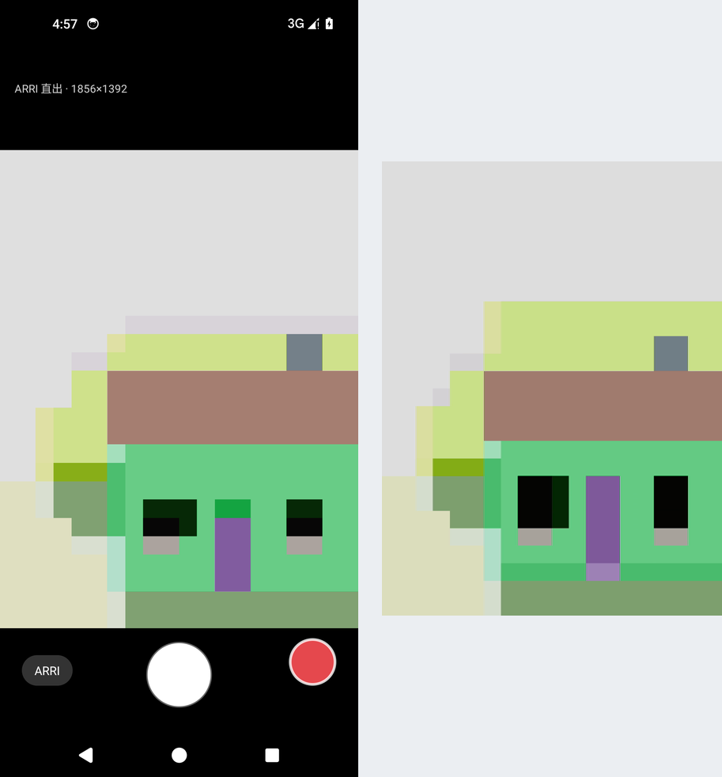

# MAGIRRI Lume — 直出 ARRI 色彩的相机

独立相机 App，不依赖手机自带相机，也不依赖 Magri。打开就是实时 ARRI 影调的取景器，
按快门直接出片，**颜色口径和 Vex 一致**。

左：取景器（带影调）　右：录下来的一帧（1080×1440，影调已烘进去）



## 为什么它能和 Vex 对上色

Vex 的链是：

```
Magic-Log 码值 → [荣耀还原 LUT] → Rec.709 → 解码 → 709→AWG3 → LogC3 → [ARRI LUT] → [仿阿莱影调]
```

第三方相机拿不到 Magic-Log，但**相机给出的画面本身已经是 Rec.709 显示码值** ——
也就是「荣耀还原 LUT 的输出」。所以把第一步换成恒等（v → v），后面整条链原样保留：

```
相机 Rec.709 → [恒等] → Rec.709 → 解码 → 709→AWG3 → LogC3 → [ARRI LUT] → [仿阿莱影调]
```

同一套矩阵、同一套 LogC3 编码、同一张 ARRI 官方 LUT、同一条影调曲线，所以色彩响应一致。
LUT 由 [`../vex/tools/bake_cam_lut.py`](../vex/tools/bake_cam_lut.py) 烘焙：

```bash
cd vex && python tools/bake_cam_lut.py     # → lume/app/src/main/assets/luts/arri_cam_standard.cube
```

灰轴实测（33³）：

| 输入码值 | 0.00 | 0.18 | 0.50 | 0.75 | 1.00 |
|---|---|---|---|---|---|
| 输出 | 0.030 | 0.129 | 0.540 | 0.737 | 0.876 |

中间调基本不动、高光收进电影曲线、黑位抬到 0.03 —— 和 Vex 的尾部完全一致。

## 它怎么工作

```
Camera2 预览流 → SurfaceTexture → GLES 实时查表 ─┬→ 屏幕
                                              └→ 编码器 Surface（录像）
Camera2 静态帧 → BT.709 有限范围转 RGB → CPU 查同一张 LUT → 旋转 → JPEG → 相册/MAGIRRI Lume
麦克风 → AudioRecord → AAC ────────────────────┘ 与画面合成 MP4
```

- **预览**：2D 平铺 LUT（宽 n²、高 n）+ 双线性，`GLES2` 就能跑，不依赖 3D 纹理
- **拍照**：YUV 直接转 RGB 再查表，只编一次 JPEG（不走「先出 JPEG 再解码套 LUT」那种双重损失）
- **录像**：同一帧画两遍（一遍给屏幕、一遍给编码器），画面不经过 CPU，影调和预览一致
- **对比**：左下角「ARRI / 原片」按钮实时切换，方便看影调差多少

## 安装

```
adb install -r dist/magirri-lume-1.0-debug.apk
```

最低 Android 8.0（API 26）。

## 取景比例

取景器显示**整幅画面**（等比缩放 + 四周黑边），不裁切也不拉伸，所以取景框里看到的构图
就是成片的构图。

之前是"裁切填充"——只采样中间一块再拉到全屏，取景器比成片窄一圈，看着就像比例不对。
修法是把缩放加在**顶点**上（`uQuadScale`），UV 保持 0..1 不动：缩 UV 会改变采样范围，
画面会被拉伸。

## 方向

预览和成片用**两个不同的角度**：

```
取景器角度 = 传感器方向 − 窗口方向（Display.rotation）
成片角度   = 传感器方向 − 握持方向（加速度计）
```

取景器跟窗口走：手机一横，加速度计马上就报 90°，可窗口还在转，如果取景器跟着传感器转，
中间就有一下是歪的。跟随窗口后，窗口不转取景器就不动。

成片跟握持走：这样即使系统关了自动旋转、窗口一直竖着，横着拍出来的照片/视频也是横的。

**界面随系统旋转**（没锁竖屏）：横过来拿，文字和控件一起横过来，成片也是横向的
（实测竖持 1392×1856 / 1080×1440，横持 1856×1392）。

预览里还有个历史坑：旋转 UV 得到的是画面的**反向**旋转，所以要取负号，否则预览会
比照片差 180°（第一版就是这个 bug，画面上下左右全反）。

## 暗部

影调曲线的底部是**软脚**（softplus），不是硬裁。

硬裁时输入 0.00~0.08 会被一起压到同一个值（全是 0.030），暗部细节直接消失；
改成软脚后：

| 输入 | 0.00 | 0.02 | 0.05 | 0.08 | 0.12 | 0.20 | 0.50 |
|---|---|---|---|---|---|---|---|
| 硬裁 | 0.030 | 0.030 | 0.030 | 0.030 | 0.042 | 0.160 | 0.541 |
| 软脚 | 0.025 | 0.028 | 0.033 | 0.043 | 0.065 | 0.158 | 0.536 |

中间调几乎没动（0.541 → 0.536），只把暗部拉开。参数在 `bake_cam_lut.py` 的
`--toe`（默认 0.06）和 `--lift`（默认 0.02）。

## 界面

**锁横屏**（`sensorLandscape`）。左边取景，右边两根细长波轮 + 一列按钮：

```
┌────────────────────┬──────┬───────────┐
│ 状态 / FPS          │ ▤▤▤  │      ⬤    │  ← 快门（右上角）
│                    │ ▤▤▤  │      ●    │  ← 录像（正下方，同尺寸）
│    取景（带影调）    │ 变焦 │    [S]    │  ← 模式键，单击循环
│                    │ ▤▤▤  │           │
│                    │ ▤▤▤  │           │
└────────────────────┴──────┴───────────┘
```

- **波轮是二级菜单，但是就地展开**：主界面只显示四个数值按钮（变焦 / EV / 快门 / ISO），
  排成竖列放在快门/录像的**左侧**，点一下，波轮在**面板最左侧那条位置上**展开
  （58dp 宽、满高，仍是细长造型），再点一次收起。不是浮层、不居中、不盖画面。
- 只读档位的按钮会**置灰且点不开**：M 档的 EV（只是曝光指示器）、S 档的 ISO（软件自动）；
  切档后如果正展开的波轮变成只读，会**自动收起**。
- **面板底色是纯黑**（#000），按钮各自带一块灰色圆角胶囊，两者分开：按钮有底、面板没有。
  波轮位固定占 64dp 宽，所以展开/收起时按钮位置不会左右跳。
  快门/录像固定在**右上角**，下面留白给后续要加的控件。
  录像键**外圈始终是圆形**，录制中在正中间显示一块白色圆角矩形（不是整颗键变方块）。
- **波轮外观**：横向棱纹的圆柱面朝用户，拨动时纹路上下滚动，左右两侧压暗模拟曲率。
- **波轮手感**：行程 = 控件高度的 1.6 倍走完量程（原来固定 70dp，一划就到底）；
  每拨过量程的 1/24 触发一次 `CLOCK_TICK` 振动。
- **S 档不卡的关键**：`setRepeatingRequest` 做了 60ms 合并——拖波轮时回调是像素级的，
  直接每次都下发会把相机管线灌满；另外自动 ISO 循环在用户拖轮时会主动让开。
- **S 档亮度跟手（前馈）**：曝光 ∝ ISO × 快门，所以快门一变就按比例立刻补 ISO
  （1/125 → 1/369 时 ISO 立刻 ×2.95），EV 每变一档 ISO 立刻 ×2。
  只有场景本身变化才交给 800ms 闭环微调——不会出现"亮度慢慢爬"。
- **画幅**（测光按钮下方，循环切换）：`3:2` / `16:9` / `2.35:1`。传感器是 4:3，
  画幅更宽时在纹理坐标上裁上下（GL 里 `uTexScale`），**预览、照片、录像用同一套裁切**，
  所见即所得：2.35:1 下拍照得 1856×789、录像得 1280×544。
  保留的高度比例是 `传感器画幅 / 目标画幅`（2.35:1 → 57%）。
  两个坑：① 写成 `目标/传感器` 再 clamp 到 1 会变成"没裁却按宽画幅摆放"；
  ② `glUniform2f(uTexScale, 1f, 1f)` 里硬编码的 1,1 让裁切值根本没进 shader——
  表现就是画面被压扁。核对方式：同一画幅下**照片**（CPU 裁切）和**预览截图**
  里同一元素的宽高比必须一致（2.35:1 下都是 2.05 左右）。
- **预览右对齐**：画面比视口窄时靠右贴住控制面板（`uQuadOffset`），不在中间留空。
- **测光模式**（模式键下方按钮，循环切换）：`点测` / `中央重点` / `多区`，
  对应 ARRI 曝光表的测光区域。做法是每 800ms 把画面渲到 64×48 的 FBO 再按区域加权重：
  点测取中心 4×4 小块，中央重点用高斯权重，多区取全画面平均。
- **模式键**：一个按钮，单击在 `S → AUTO → M` 之间循环，按钮上显示当前档。
  进 S/M 档时，模式键下方会多出两个小波轮（快门 / ISO）：

  | 档 | 变焦 | EV 波轮 | 快门波轮 | ISO 波轮 |
  |---|---|---|---|---|
  | AUTO | 可调 | 曝光补偿（可调） | 隐藏 | 隐藏 |
  | S | 可调 | 目标 EV（可调） | **可调** | 只读，显示自动算出的 ISO |
  | M | 可调 | **曝光指示器**（只读） | 可调 | 可调 |

  **S 档是快门优先**：用户拨快门速度，软件按设定的 EV 去调 ISO。
  实现上没有用机身的 AE（Camera2 不提供快门优先），而是自己闭环：
  每 300ms 用 `glReadPixels` 读一次取景器中心 16×16 的亮度，跟目标亮度
  （`0.45 × 2^EV`）比，按 `(目标/实测)^0.6` 调 ISO——带阻尼，不会来回振荡。
  目标亮度不可达时 ISO 会顶到机身上下限（截图里就是 +3EV 把 ISO 顶到 1600）。

  **M 档**：EV 波轮退化成曝光指示器，指针位置表示当前偏离 0.45 中性灰多少个
  档（±2 档范围），只读。

- **变焦**：`CONTROL_ZOOM_RATIO`（API 30+），更早的系统退回到 `SCALER_CROP_REGION` 裁切。
  滑条取对数，低倍率段更好调。上限读的是相机报的 `CONTROL_ZOOM_RATIO_RANGE`。
- **曝光**：`CONTROL_AE_EXPOSURE_COMPENSATION`，档位和范围都从
  `CONTROL_AE_COMPENSATION_RANGE/STEP` 读，0 EV 落在滑条中间。
- 相机不支持某一项时，对应滑条变灰且不响应触摸。
- 左下角有实时读数：`FPS · GL · ENC`。卡的时候先看这三个数——GL 高是渲染重，
  ENC 高是编码器在积压。

方向这块踩了两个坑，都是"看起来对、实际全错"的类型：

1. **锁横屏后 `Display.rotation` 仍是 0**（设备物理竖持）。直接拿它算取景器角度，
   画面会被转成一条竖的。改成用窗口真实像素尺寸判断横竖，只在系统真的转过
   （rotation 非 0）时才采信它，并且加了一条安全网：横屏窗口里算出来的角度若落在
   90/270（只会得到竖画面），直接拉回 0/180。
2. **`GlPreview.rotationDeg` 没有 setter**，赋值后不会重算等比缩放，于是永远用
   旧角度算出的条状缩放——这是"画面一直是竖条"的真正原因。现在 setter 里会
   `computeScale()`。

## 录像

- **4K**：相机额外输出一路 4K（3840×2160）录制流，编码器直接吃这一路，不是把预览
  放大——预览可以低分辨率，成片必须是真 4K。机型给不了 4K 时按 1080p → 720p 退。
- 30fps，H.264；码率按 `宽×高×30×0.12` 算，4K 约 30 Mbps（上限 40 Mbps）
- 音轨 AAC 44.1kHz 单声道，128 kbps；没有录音权限时自动降级成无声录像
- 存到 `相册/Movies/MAGIRRI Lume`
- 录制中左下角显示计时；再点一次红色按钮停止并保存

六个坑记一下：

1. **`EGL_RECORDABLE_ANDROID` 必须开**。MediaCodec 的输入 Surface 只认带这个标记的
   EGL config；用默认 config 时 `eglCreateWindowSurface` 返回 `EGL_NO_SURFACE`
   **而不抛异常**，一帧都进不了编码器，最后就是"录像保存失败：编码器没有输出有效帧"。
   现在 `GlPreview` 自带 config chooser（recordable 优先，失败才退回普通 config），
   并且检查 `eglCreateWindowSurface` 的返回值。
2. `SurfaceTexture` 的 `timestamp` 是 `System.nanoTime()` **绝对值**，直接当 PTS 用，
   音轨从 0 开始、画轨从 1e14 开始，MP4 时长会算成几百秒。必须减去开始时的基准。
3. 编码器吃的是相机的**每一帧**——预览流常常是 60fps，不加节流就是每秒编码 60 帧、
   每帧画两遍，GL 线程被压满，整个取景器跟着卡。现在按 30fps 跳帧。
4. **编码器积压会反噬取景器**：`eglSwapBuffers` 到编码器 Surface 在队列满时会阻塞
   GL 线程。所以做自适应——swap 超过 15ms 就把编码帧率减半（最低 10fps），先保取景器。
5. 停止有顺序：先让 GL 线程停止写编码器（并等它确认），再 `signalEndOfInputStream`，
   最后才 `muxer.stop()`。反过来的话编码器停了而 GL 还在 swap，muxer 收到废数据，
   表现就是"录完了保存失败"。
6. 别给编码器设 `KEY_COLOR_STANDARD/TRANSFER/RANGE`——个别机型见到不认识的组合会
   退化到软件编码，那就是肉眼可见的卡。

## 现在能做什么 / 还不能做什么

**能**：实时取景预览（带影调）、全分辨率拍照直出、带声音的录像、ARRI/原片一键对比。

**还不能**：

- **没有 Log**。相机 SDK 不开放 Magic-Log，所以输入是手机相机的标准 SDR 画面。
  和 Vex 比，色彩一致，但**动态范围比不上 Log**——高光在相机内部就已经压过了。
- **拍照处理 3~4 秒**（模拟器软件渲染；真机快很多）。瓶颈是逐像素 CPU 查表和
  Bitmap 编码，后续可以改成离屏 GL + `glReadPixels`，预计能到 0.3 秒内。
- **8MP 上限**。再大的 ARGB 位图要吃 30MB+，中端机容易 OOM。真机可以按内存动态放宽。
- 没有变焦、闪光灯、HDR 合成、美颜、网格线这些。

## 结构

```
lume/
  app/src/main/java/com/magirri/lume/
    MainActivity.kt   取景器 UI + 快门 + 权限
    CameraEngine.kt   Camera2 打开、预览、YUV 静态帧
    GlPreview.kt      实时 LUT 预览（GLES2，shader 内联）
    PhotoProcessor.kt YUV→RGB、CPU 查表、旋转、JPEG 落盘
    VideoRecorder.kt  H.264 + AAC + MP4 封装
    OrientationTracker.kt 加速度计判横竖
    Lut3D.kt          .cube 解析 + 快速采样（免分配）
  app/src/main/assets/luts/arri_cam_standard.cube
```

## 最近一轮修复

- **保存目录**：`Movies/MAGIRRI Lume`、`Pictures/MAGIRRI Lume`（原来还叫 ArcCam）。
- **启动占位**：相机出画前，在取景位置显示黑底白字的 logo；第一帧到达后 220ms 淡出，
  6 秒兜底——相机起不来也不会一直挡着。
- **录像时长**：pts 从相机时间戳（`CLOCK_BOOTTIME`，含休眠）改成 `System.nanoTime()`
  （`CLOCK_MONOTONIC`）的差值。手机睡过一两晚两个时钟能差几十小时，成片时长就成了几千分钟。
- **录像中锁画幅**：编码尺寸已经定死，切画幅会写出尺寸不一致的流，所以录制时按钮置灰不可点。
- **录像键**：外圈恒定圆形，录制中中心显示白色**圆角正方形**。
- **波轮方向**：纹路滚动方向改成跟手——往上拨、值变大，纹路也往上跑。

## 变焦

变焦是**纯 GL 数字变焦**：只改采样 UV 的范围，不碰相机。
之前每拨一下都 `setRepeatingRequest` 改 `SCALER_CROP_REGION`，相机管线不停重新收敛，
画面一顿一顿的；现在 `GL 0.6~0.8ms`、拖动全程 27~29fps。

- `targetZoom` 由拨轮设，`zoomNow` 每帧向它靠 28%，所以再快的拨动也是滑过去的。
- 照片按同一倍率居中裁切（2× + 3:2 → 927×618），构图和取景器一致。
- 录像走同一个 `drawFrame`，自动跟着变焦。
- 代价：预览在高倍率下是放大裁切，会变软；照片仍从全画幅裁，画质不受影响。

## 对焦

模式键下面的 `AF-S / AF-C / MF` 按钮循环切（在测光与画幅之间）：

| 模式 | 相机侧 |
|---|---|
| AF-S | `CONTROL_AF_MODE_AUTO` 单次 |
| AF-C | `CONTROL_AF_MODE_CONTINUOUS_PICTURE` 连续 |
| MF | `CONTROL_AF_MODE_OFF` + `LENS_FOCUS_DISTANCE` |

MF 档时，**变焦按钮上方**多出「对焦」按钮，点开是同款细长波轮。
波轮按**屈光度**线性映射（0 = ∞，越大越近），显示成 `∞ / 1.2m / 23cm`。
最大屈光度取 `LENS_INFO_MINIMUM_FOCUS_DISTANCE`，为 0 的机器（定焦模组）会自动跳过 MF。

## 点击对焦 / 设置页

- **点击对焦**：AF-S / AF-C 下点取景器任意位置即对焦到该点，屏幕闪一个黄圈。
  做法是把点击点按着色器那套变换（旋转 → 裁切 → 变焦）**正算**回相机纹理 UV，
  再换算成 sensor 的 metering 矩形，`CONTROL_AF_TRIGGER_START` 触发一次扫描后恢复重复请求。
  MF 档忽略点击。
- **设置页**（左上角按钮）：画幅 / 分辨率 / 帧率。
  - 画幅即时生效（`3:2 / 16:9 / 2.35:1`），面板上的画幅按钮已移除。
  - 分辨率 `4K / 1080P / 720P`、帧率 `24 / 30 / 60` 会**重启相机**（`close()` +
    `reemitSurfaces()`），因为录制流尺寸和 AE 帧率区间在开会话时就定死了。
  - 帧率同时写进 `CONTROL_AE_TARGET_FPS_RANGE` 和编码器。

## 状态栏与设置入口

- 系统通知栏已隐藏（`FLAG_FULLSCREEN` + `WindowInsets`），顶部自己画一条 **22dp** 的窄条：
  左边时间（20 秒刷一次），右边电量百分比（充电时带 ⚡）。
- 设置入口是**右下角的齿轮**（圆形半透明底），点开设置页，点空白处关闭。
- 坑：`window.insetsController` 在 `setContentView` 之前是 null，直接调用会 NPE；
  另外 `setDecorFitsSystemWindows(false)` 会让内容伸到横屏右侧的导航栏底下，按钮被裁掉——别用。

## 按钮尺寸

- 测光改成两个字：**点测 / 中央 / 多区**。
- 模式键、测光键、对焦键统一 `66 × 36dp` 固定尺寸，切换文案不再跳宽。
- 数值按钮（变焦/EV/快门/ISO/对焦）内边距收到 10dp，给 `快门 1/125` 这种长文案留够宽度。

## 点击对焦的两次修正

一开始「点十次对三次」，两个原因：

1. **黑边把点击吃掉了**：16:9 / 2.35 下画面只占一块，点到黑边时 `previewPointToUv` 直接
   返回 null 就没了反馈。现在改成**把点击钳到画面边缘**，永远有响应。
2. **AF 触发被重复请求冲掉**：原来是「单次 `capture()` 触发 + 立刻恢复重复请求」，
   那条重复请求经常把还没执行的触发覆盖掉。现在改成**触发位置位法**：
   `afTrigger = START` → 随重复请求下发 → 在 `onCaptureCompleted` 里看到
   `CONTROL_AF_STATE` 变成 FOCUSED/NOT_FOCUSED/INACTIVE 后复位成 IDLE。

顺带修了返回键：设置页开着时按返回只关设置页，不会直接退出应用。

## 排版

- 模式 / 测光 / 对焦 / 设置四个按钮统一 `66×36dp` 胶囊，间距 6dp，设置按钮排在对焦下面。
- 顶栏左右各留 44dp 安全区，时间与电量不会被屏幕 R 角吃掉。
