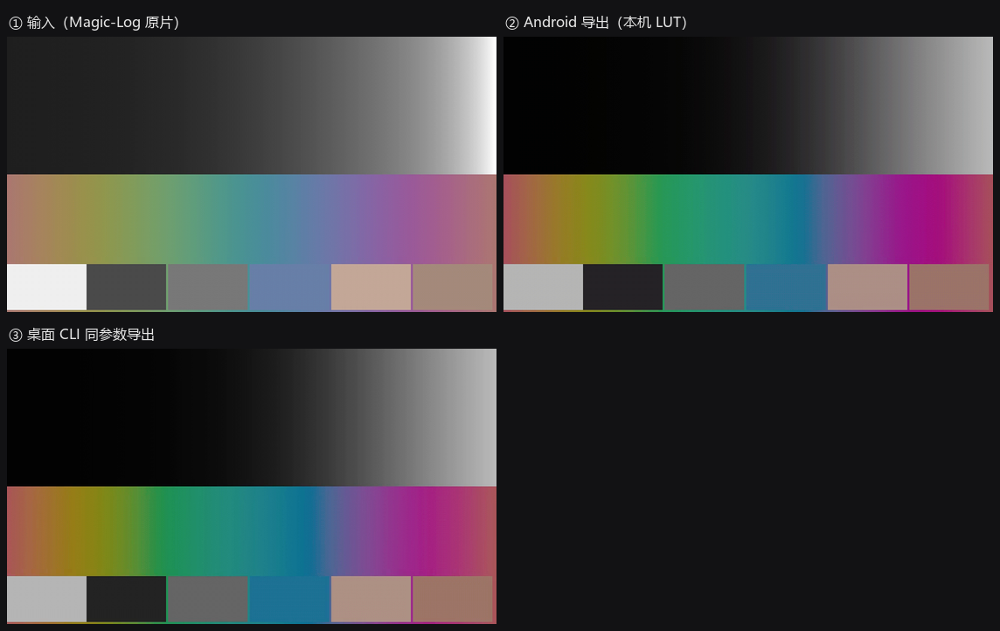

# MAGIRRI Vex — Log 视频一键出片（仿阿莱影调）

选一个手机拍的 Magic-Log 视频，点一下，导出带阿莱味道的成片。
**影调是固定烘焙的**：不随素材变、不需要手动调、软件里没有任何滑杆。

两个入口，同一条色彩链：

| 入口 | 说明 |
|---|---|
| **安卓 App（MAGIRRI Vex）** | [`android/`](android/README.md) — 三页界面 + 液态玻璃底栏，装完点两下就出片，默认存到 `相册/MAGIRRI Vex`：`android/dist/magirri-vex-2.0-debug.apk` |
| **桌面命令行** | 本文 —— 走 ffmpeg，10-bit 无损，适合批量 / 高质量交付 |

App 把整条链烘成 33³ LUT 打进 APK，手机只做一次查表；桌面烘成 65³ 交给 ffmpeg 的
`lut3d`。同一段素材，两端 ΔE2000 均值 **1.62**（见[效果](#效果)）。

```bash
# 安卓：首页 → 调色页选视频、选风格 → 导出（默认进相册/MAGIRRI Vex）
adb install -r android/dist/magirri-vex-2.0-debug.apk

# 桌面
python -m vex export 我的视频.mp4 -o 成片.mp4
```

## 新方案：为什么不是"官方 LUT 直接用"

```
Magic-Log 码值
  → [荣耀官方还原 LUT]      Magic-Log → Rec.709 显示码值
  → [解码成线性]            BT.709 OETF 逆
  → [709 → AWG3 基色]       阿莱的摄影机基色
  → [LogC3 EI800 编码]      线性 → LogC3 码值
  → [ARRI 官方 LogC3 LUT]   阿莱的色彩科学
  → [仿阿莱成品影调]        固定曲线：收掉留给后期的余量   ← 新增
  → Rec.709 8/10-bit
```

问题出在倒数第二步。**ARRI 的 LogC3→Rec.709 是"给后期留余量"的转换**：
LogC3 要拉到 1.0（线性 55）才到纯白，而手机 Magic-Log 的高光只到 0.55 左右，
套完白点停在 0.68、黑点停在 0.16 —— 整片发灰，这正是"官方 LUT 必须手动调"的原因。

### 为什么不是去下载一个开源 LUT

查过了，没有能用的：

- **ARRI Look Library** 是专有资产，授权不允许再分发；
- GitHub 上能找到的是[影调胶片模拟（MIT）](https://github.com/JanLohse/spectral_film_lut)，
  那是胶片仿真，不是阿莱；
- 还有一批 "ARRI 转换 LUT"（如 [ocio-blender-default 里的 AlexaV3 系列](https://github.com/sobotka/ocio-blender-default/tree/arri-reference/luts)），
  但那些就是留余量的转换版本，换了等于没换。

所以这一层由项目自己做：**保留 ARRI 的色彩科学（AWG3 基色 + 官方 LUT），
把成品影调按固定参数补上，一起烘进 `.cube`**。

### 固定的五个常数

| 常数 | 值 | 作用 |
|---|---|---|
| `LOOK_PIVOT` | 0.46 | 中灰落点，反差绕着它转，所以整体亮度不漂 |
| `LOOK_CONTRAST` | 1.38 | 反差强度 |
| `LOOK_LIFT` | 0.030 | 黑位抬升，≈ 胶片最低密度，不压死黑 |
| `LOOK_EXPOSURE` | 0.35 | 伽马提亮（0→0 / 1→1，结构上不可能过曝） |
| `LOOK_KNEE` | 0.85 | 高光软肩起点，过了这一点指数逼近 1.0，不硬裁 |

定义在 [`vex/bake.py:119-135`](vex/bake.py#L119-L135)，曲线本身是
[`arri_look()`](vex/bake.py#L126)。四个步骤全部单调，所以整条曲线单调，
不会出现反转或色阶断层。

**想要别的风格**：改这五个常数，重新烘焙即可，不用动 App 代码。

```bash
python tools/bake_app_luts.py --size 33      # 重烤 App 的 4 个 LUT
```

比如要更电影感 → `LOOK_CONTRAST=1.45`、`LOOK_LIFT=0.02`；要更柔和 → `LOOK_CONTRAST=1.25`。

## 效果

同一条真机素材（4K60 10-bit HEVC、竖屏）：

| | 亮度均值 | 黑点 p1 | 中位 p50 | 白点 p99 | 死黑占比 | 过曝占比 |
|---|---|---|---|---|---|---|
| Magic-Log 原片 | 0.546 | 0.297 | 0.512 | 0.827 | 0% | 0% |
| ARRI 官方转换（旧） | 0.445 | 0.019 | 0.436 | 0.807 | 0.26% | 0% |
| **仿阿莱成品影调（现行）** | **0.509** | **0.119** | **0.509** | **0.802** | **0%** | **0%** |

暗部从 0.019 抬到 0.119（不再死黑），白点基本持平，两端都不裁切。

App 与桌面的一致性（同一段素材，Surface 快通路 vs 桌面 CLI）：

| 对比 | ΔE2000 均值 | 中位 | P95 |
|---|---|---|---|
| **App 导出 vs 桌面 CLI** | **1.62** | 1.57 | 3.88 |
| 其中肤色/灰阶块 | 3.09 | — | 7.77 |
| 参照：原片 vs 成片 | 13.96 | — | — |

剩下的 2~4 来自三处可量化差异：App 用 33³ + 三线性、桌面用 65³ + 四面体；
App 输出 8-bit 4:2:0、桌面 8/10-bit 4:4:4；以及 4:2:0 的色度抽样。



## 命令一览

| 命令 | 干什么 |
|---|---|
| `export` | 选视频 → 套 LUT → 导出（主流程） |
| `compare` | 抽一帧，把三种解码假设并排画出来，30 秒定参数 |
| `bake` | 只把整条链烘焙成一个 `.cube`，丢进 Resolve/Premiere 用 |
| `assets` | 查看 / 重新下载官方 LUT |
| `verify` `info` `probe` | 老工具：跑验证报告、看 LUT 头、标定 LUT 有效域 |

常用参数：

```bash
# 换机型对应的还原 LUT（v1 老机型 / v2 新机型）
python -m vex export in.mp4 -o out.mp4 --log v1

# 换风格（standard / classic）
python -m vex export in.mp4 -o out.mp4 --look classic

# 想完全用官方转换、不要成品影调（对比用）
python -m vex export in.mp4 -o out.mp4 --no-look

# 先看效果再决定：生成四联对照图
python -m vex compare in.mp4 -o look.png --at 3.5

# 交给 Resolve 继续调：输出 4:4:4 + 保留链 LUT
python -m vex export in.mp4 -o out.mp4 --yuv 444 --crf 12 --keep-lut chain.cube

# 只想拿 LUT
python -m vex bake -o chain.cube --log v2 --look standard
```

## 两个"必须知道"的参数

**`--mid-transfer`（默认 `bt709`）** —— 还原 LUT 输出的是显示码值，要解码成线性光
才能进 LogC3。厂商没写它用的是 BT.709 OETF 还是显示 gamma，这一步错了中灰会差
0.3~0.9 档。

默认取 `bt709` 的理由：拿荣耀 v2 的 LUT 反推，它的中灰（18% 灰）落在输入码值
0.47 附近刚好对应 BT.709 的 0.409；若按 gamma 2.4 解释则要假设中灰在 0.53，
离手机 Log 的常见落点更远。**这是推断，不是厂商声明**——拿不准就跑一次
`compare`，三张图并排看 30 秒就有答案。

**`--output-transfer`（默认 `keep`）** —— ARRI 的 SDR LUT 输出的是 **gamma 2.4**
（文件名里的 `Gamma24`），不是 BT.709 OETF。写进 bt709 标记的文件，现代播放器会用
BT.1886（≈2.4）EOTF 还原，正好对上。所以默认不要转；只有严格 OETF 交付才用
`--output-transfer bt709`。

## 验证过的部分

`python tools/verify_export.py --input in.mp4 --output out.mp4` 会抽同一帧，
用 Python 侧独立算一遍链，再和导出视频解出的帧比 ΔE2000：

| 检查项 | 实测 |
|---|---|
| 10-bit 导出 vs Python 链 | 平滑区 ΔE 均值 **0.20**、P95 0.45（阈值 <1.0 / <2.5） |
| 8-bit 导出 | ΔE 均值 1.39（8-bit 量化本身的代价，仍在阈内） |
| 对照：完全不套 LUT | ΔE 均值 13.1（说明 LUT 确实生效） |
| 位深 / 音轨 / 时长 | 10-bit 保住、AAC 音轨复制、时长一致 |
| 速度（1080p） | libx265 0.7x 实时 / NVENC 1.5x 实时 |

也就是说：**ffmpeg 里发生的和 Python 里算的一致**——LUT 通道顺序、10-bit 链路、
YUV 范围都没被悄悄搞坏。

## 目录

```
vex/
  bake.py      整条链 → 单个 3D LUT（含仿阿莱成品影调 arri_look）
  export.py    ffmpeg 封装：探测 / 抽帧 / 导出 / 进度 / 对照图
  luts.py      官方 LUT 资产表（路径 + 适用机型 + 来源）
  cube.py      .cube 解析与四面体/三线性采样
  color.py     基色→矩阵推导、709↔AWG3、Lab
  transfers.py LogC3(EI800)、Rec.709 OETF 及逆、sRGB
  pipeline.py  早期逐帧参考管线（verify 报告用）
  verify.py    桌面参考实现的完整实验报告
  android/     Android App（Kotlin，MediaCodec + GLES，无需 AndroidX）
assets/luts/   官方 LUT 的**落位目录**（不入库，见下）+ 来源说明 SOURCES.md
glsl/          OpenGL ES 3.0 着色器（与 App 内着色器同源）
tools/         测试素材生成、端到端验证脚本
samples/       我这边生成的测试素材与导出结果（不入库）
```

## 第一次跑之前：拉取厂商 LUT

荣耀和 ARRI 的官方 LUT 是**受权资产，不随仓库分发**（`assets/luts/**` 已在
`.gitignore` 里排除，只留 `SOURCES.md` 说明来源）。第一次 clone 之后先跑：

```bash
python -m vex assets fetch     # 下载并校验官方 LUT
python -m vex assets list      # 看看都在不在、灰轴对不对
```

App 里的 4 个链 LUT 同样是构建产物，需要在有 assets 的前提下重烤：

```bash
python tools/bake_app_luts.py --size 33
```

## 三条硬边界

1. **还原 LUT 必须和机型对得上。** v1/v2 是两代曲线，荣耀按机型分两包发布。
   用错了不是"稍微偏一点"，而是整体对比和色相都错。App 里可以导入后自动判断
   这段素材像不像 Log，但对不上机型只能靠人在设置里选。
2. **宽容度上限由路线决定。** 还原 LUT 输出 Rec.709 的那一刻，709 白点以上的
   高光就没了（实测顶部损失 5.8 档）。后面的 LogC3 只是换包装，不会长出信息。
3. **成品影调是固定的，不是自适应。** 同一台机器、同样的曝光习惯，出来的片子
   影调一致；但如果你一半素材欠曝、一半过曝，它不会替你逐条修正 —— 这是刻意的
   取舍：宁可一致，也不要"这条亮那条暗"。

## 早期那份参考实现

> **时效提醒**：那份报告生成于 AWG3 基色修正之前，涉及色域转换的数字已经过时。
> 修正内容见 [`android/README.md`](android/README.md) 踩坑表里「蓝色变成紫色」那条。

`report/report.md` 里还留着上一阶段的东西：逐帧管线、E0–E5 全部实验、以及
对手册里 4 处技术细节的修正（`.cube` 填充顺序、LogC3 输出范围、AWG3 是否包含 709、
RAW 与 3A 的关系）。那一套用合成 LUT 跑，证明的是"数学和实现没错"；
本 README 这一套用官方 LUT 跑，证明的是"端到端没被搞坏"。两者互补。

```bash
python -m vex verify --out report      # 重跑那份报告
python -m unittest discover -s tests        # 30 个单元测试
```

## 免责声明

- 与 ARRI 集团无任何合作、授权或从属关系；ARRI 等商标归其权利人所有。
- 影调是**自制曲线**，只是"近似"电影观感，不是任何厂商的官方 LUT 或色彩科学。
- 软件按"现状"提供，不提供任何担保；使用后果由使用者自负。
