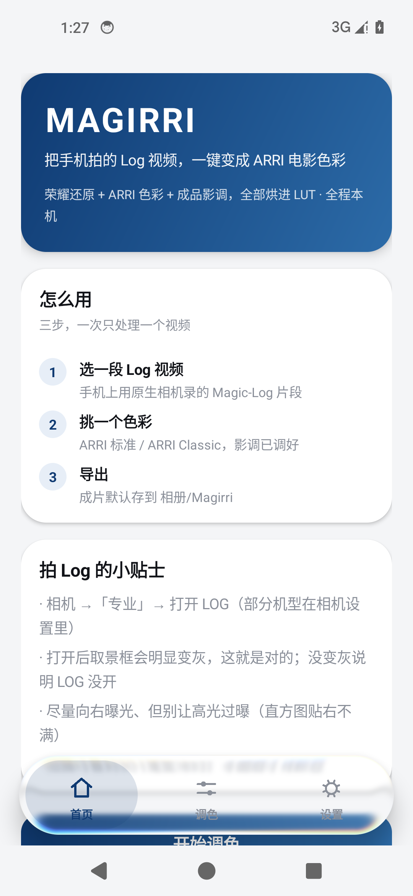
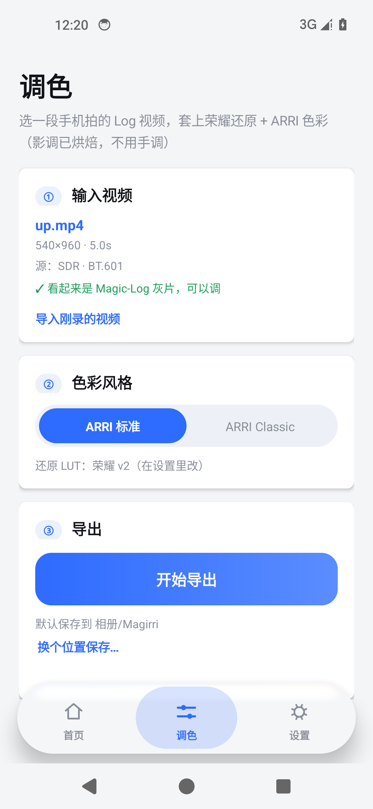
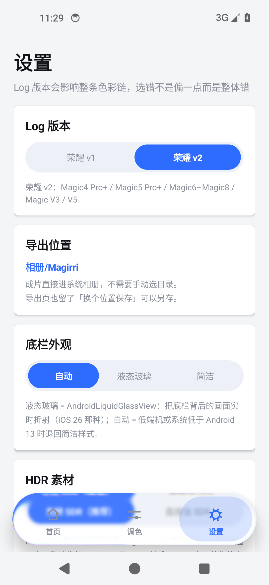

# MAGIRRI Vex · Android 版

把手机拍的 Log 视频，一键变成 ARRI 电影色彩。
色彩链用的是**厂商官方 LUT**（荣耀 Magic-Log 还原 + ARRI LogC3），最后再套一层本项目烘焙的
**仿阿莱成品影调**——官方转换是给后期留余量的，不补这一层画面会发灰。全程离线，不上传任何画面，
**软件里没有任何滑杆**。

| 首页 | 调色 | 设置 |
|---|---|---|
|  |  |  |

## 安装

编译好的调试版在 [`dist/magirri-vex-2.0.1-debug.apk`](dist/magirri-vex-2.0.1-debug.apk)（8.0 MB，含液态玻璃库的 AndroidX 传递依赖）。

```bash
adb install -r dist/magirri-vex-2.0.1-debug.apk
```

或者把 APK 拷进手机点开安装（需要在系统里允许"未知来源"）。
最低 Android 8.0（API 26），arm64 / armeabi-v7a。

## 三页

**① 首页** — 这是什么、怎么用（三步）、拍 Log 的小贴士，底部「开始调色」直接进工作页。

**② 调色（工作页）**
1. 「输入视频」— 点卡片选一段用原生相机录的 Log 片段，选完显示文件名 / 分辨率 / 时长；
   下面还有「导入刚录的视频」，直接抓相册最新一条
2. 「色彩风格」— ARRI 标准 / ARRI Classic 二选一
3. 「导出」— 一键出片，**默认存到 `相册/MAGIRRI Vex`**，相册里直接能看到；导完可以「打开」「分享」，
   想换个地方就点「换个位置保存…」走系统文件选择器

**③ 设置**
- **Log 版本**：荣耀 v1 / v2。这是整条色彩链的入口，选错不是偏一点而是整体对比和色相都错
- 底栏外观：自动 / 液态玻璃 / 简洁
- 关于：色彩链说明、LUT 来源

| 素材来自 | 选哪个还原 LUT |
|---|---|
| Magic3 / Magic V / Magic4 / Magic5 / Magic Vs / Magic V2 | 荣耀 **v1** |
| Magic4 Pro+ / Magic5 Pro+ / Magic6–Magic8 / Magic V3 / V5 | 荣耀 **v2** |

## 液态玻璃底栏

底栏玻璃**不是自己写的**，直接用了
[AndroidLiquidGlassView](https://github.com/QmDeve/AndroidLiquidGlassView)（MIT）：

```kotlin
implementation("com.qmdeve.liquidglass:core:1.1.0")   // Maven Central
```

它把底栏背后的页面容器录进 `RenderNode`，再用 AGSL 运行时着色器在 GPU 上做
**边缘折射 + 色散 + 模糊**，所以背景是"被玻璃厚度弯折"，不是蒙一层白。

| 参数 | 值 | 说明 |
|---|---|---|
| `cornerRadius` | 胶囊半高 | 跟随尺寸 |
| `refractionHeight` | 18dp | 多厚的边参与弯折 |
| `refractionOffset` | 40dp | 弯折的位移量 |
| `dispersion` | 0.55 | 边缘彩边强度 |
| `blurRadius` | 10 | 背后的模糊（真液态玻璃也有这一层） |
| `tintAlpha` | 0.10 / 0.20 | 浅色 / 深色染色 |

**接入时要注意的三件事**（都踩过）：

1. 库的 AAR 声明 `compileSdk 37`，本项目用 34 —— 打开
   `android.experimental.disableCompileSdkChecks=true` 才能过 AAR 检查；
2. 它的 AndroidX 传递依赖带进来 Kotlin 2.2 的 stdlib，和本项目的 Kotlin 1.9 编译器不兼容，
   需要用 `resolutionStrategy.force("org.jetbrains.kotlin:kotlin-stdlib:1.9.24")` 压回去；
3. 库只在 **API 33+** 才创建渲染实现（需要运行时着色器），低版本是空的，
   所以 `GlassBar` 自己保留了一层回退。

**回退**：设置里选「简洁」，或系统 < Android 13 —— 退化成不透明胶囊 + 细边，
不做抓帧不做模糊。低内存设备默认走回退。
## 它做了什么

```
Log 视频 → MediaCodec 解码 → Surface
         → GLES：一次 LUT 查表（33³，2D 平铺纹理 + 三线性）+ 8×8 Bayer 抖动
         → MediaCodec 编码（优先 HEVC，失败退 H.264）→ MP4 → 相册/MAGIRRI Vex
```

**色彩数学不在手机里**：整条链（还原 LUT → 解码 → 709→AWG3 → LogC3 → ARRI LUT →
仿阿莱成品影调）在桌面端烘成一个 33³ 的 `.cube`，随 APK 打包。手机只做一次查表，
所以手机和桌面导出的结果口径一致，影调也不随素材漂。

重新烘焙：

```bash
python tools/bake_app_luts.py --size 33     # 生成 assets/luts/*.cube
```

## 效果

同一帧：左边是手机直出的 Magic-Log 原片（灰、平），中间是 App 导出的成片，
右边是桌面 CLI 用同一套 LUT 导出的结果。


实测（960×540、2 秒、8-bit H.264 素材，荣耀 v2 + ARRI 标准）：

| 对比 | ΔE2000 均值 | 中位 | P95 | 最大 |
|---|---|---|---|---|
| **Surface 快通路**（HEVC）vs 桌面 CLI | **1.62** | 1.57 | 3.88 | — |
| **缓冲通路**（H.264，兜底）vs 桌面 CLI | 约 2.5 | — | — | — |
| 其中肤色/灰阶块（下 1/3，快通路） | 3.09 | — | 7.77 | — |
| 原片 vs App 导出（变化幅度参考） | 13.96 | — | — | — |

剩下的 2～4 来自三处可量化的差异：App 用 33³ LUT + 三线性、桌面用 65³ + 四面体；
App 输出 8-bit 4:2:0、桌面 8/10-bit 4:4:4；以及 4:2:0 的色度抽样。

### 拍摄：不做"打开相机"，只保留"导入刚录的视频"

早期版本里有个「打开相机拍 Log」的按钮，**实测没用，已删除**：

- `ACTION_VIDEO_CAPTURE` 拉起的是相机的**精简录像模式**，里面没有电影模式、更没有 LOG；
- 换成 `getLaunchIntentForPackage("com.hihonor.camera")` 打开完整相机 App 虽然能进去，
  但录完还要用户自己回来找文件——比直接在系统相机里录、再回 App 选片多绕一步；
- Magic-Log 是相机 App 的私有能力（厂商 HAL + 签名级权限），第三方 App 自己录不出来。

现在只保留「**导入刚录的视频**」：录完回到 App 点一下，直接抓相册里最新一条（首次会申请
`READ_MEDIA_VIDEO` / `READ_EXTERNAL_STORAGE`），省掉翻相册的步骤。

首页的贴士仍然告诉用户 LOG 开关在哪：**相机 →「更多」→「电影模式」，顶部打开 LOG，
取景框明显变灰就对了**。
### 自动判断"这段到底是不是 Log"

用户最容易踩的坑就是以为开了 LOG、实际录的是普通视频。灰片有三个特征，
导入时直接量（`LogDetector`）：

| 指标 | Magic-Log 灰片 | 普通视频 |
|---|---|---|
| 黑位（1% 分位） | 0.29 左右（压不到 0） | 0.09 左右（贴地） |
| 高光（99% 分位） | ≤ 0.9 | 可到 0.95+ |
| 饱和度 | 低（0.06） | 正常（0.1+） |

判成普通视频会在输入卡片上直接提示：
「⚠ 这更像普通视频（没开 LOG）。相机 → 更多 → 电影模式，打开 LOG 再录一段」。

灰片/普通视频两条实测样例都能正确分类（黑位 0.292 → LOG，0.086 → NORMAL）。

### 影调：固定「仿阿莱」曲线，烘进 LUT

ARRI 官方的 LogC3→Rec.709 是**给后期留余量**的转换：LogC3 要拉到 1.0（线性 55）
才到纯白，手机 Log 高光只到 0.55 左右，套完白点停在 0.68、整片发灰 —— 所以官方
流程里必须手动拉对比度。

**为什么不去下载一个开源 LUT**：查过，ARRI 的 Look Library 是专有资产、不可再分发；
GitHub 上能找的只有 [影调胶片模拟（MIT）](https://github.com/JanLohse/spectral_film_lut)
和 ARRI 的**转换** LUT（同样是留余量的版本，等于没解决问题）。

所以做法是：保留 ARRI 的色彩科学（AWG3 基色），把成品影调按固定参数烘进 LUT：

```python
LOOK_PIVOT = 0.46      # 中灰落点
LOOK_CONTRAST = 1.38   # 绕支点的反差
LOOK_LIFT = 0.030      # 黑位抬升，0.03 ≈ 胶片最低密度，不压死黑
LOOK_EXPOSURE = 0.35   # 伽马提亮，0→0 / 1→1，结构上不会过曝
LOOK_KNEE = 0.85       # 高光软肩起点
```

三个好处：**参数固定**（同一台机器出来的片子影调一致，不会这条亮那条暗）、
**运行时零计算**（影调在 `.cube` 里，渲染还是一次查表）、**可复现**（改常数重新烘焙即可）。

同一条素材实测：

| | mean | p1 | p50 | p99 | 死黑 | 过曝 |
|---|---|---|---|---|---|---|
| ARRI 官方转换（留余量） | 0.445 | 0.019 | 0.436 | 0.807 | 0.26% | 0% |
| **仿阿莱成品影调** | **0.509** | **0.119** | **0.509** | **0.802** | **0%** | **0%** |

暗部从 0.019 抬到 0.119（不再死黑），白点持平，两边都不裁切。

**软件里不再有任何运行时调整**：没有自动分析、没有滑杆、没有逐素材参数。
### 素材发灰？也先看源是不是 HDR

同一场景两条素材，一条正常一条发灰 —— 最常见的成因是**一条是 HDR(HLG)、一条是 SDR**。
HLG 的信号按 SDR 解释会整体压平，看上去就是"没调色"。

App 现在会读源素材的 `color-transfer` / `color-standard`，直接显示在工作页上：

- `源：HLG（HDR）· BT.2020 → 已转 SDR 再套 LUT`（橙色 = HDR）
- `源：SDR · BT.709`（灰色 = 普通 SDR）

检测到 HLG 时会先按 BT.2100 逆 OETF 转成 SDR 再套 LUT（设置里可关掉做对比）。
输出也会显式标记成 Rec.709 / SDR / 有限范围，避免播放器自己猜。
### 旋转（竖屏 / 倒装素材）

手机上拍的竖屏视频，实际是「横向码流 + 旋转元数据」。导出必须转回来，
否则就是"竖屏变横屏被拉长""横屏上下颠倒"。四种元数据都实测过：

| 元数据 | 输出尺寸 | vs 桌面 CLI（ΔE2000 均值） |
|---|---|---|
| 0°（正常横屏） | 960×540 | 2.57 |
| 90°（竖屏） | 540×960 | 2.55 |
| 180°（倒装） | 960×540 | 2.54 |
| 270°（竖屏另一种） | 540×960 | 2.56 |

做法：**先把旋转从解码器配置里摘掉**（不同厂商解码器对这个字段的处理不一致，
有的会自己转，模拟器就是），让解码器永远只输出"编码朝向"；再在渲染层的
**采样坐标**上转 `-rotation`，同时把输出宽高对调。

两个坑都在这里：转顶点会把非方形画面拉斜（竖屏素材尤其明显），
而"再叠一次 +rotation"会转两遍。

## 两条送帧通路（自动选）

| 通路 | 条件 | 特点 |
|---|---|---|
| **Surface 编码** | 编码器能给出输入 Surface | 最快，GL 直接画进编码器缓冲 |
| **缓冲编码** | 上一条起不来（模拟器、部分老机型） | GL 画到离屏 pbuffer → `glReadPixels` → RGBA→YUV → 喂 ByteBuffer |

缓冲模式是兜底通路：编码器不再需要 gralloc 分配 `YCBCR_420_888 + HW_VIDEO_ENCODER` 的缓冲，
输出 YUV 走 `getInputImage()`，平面布局和行跨度由编码器自己给出。
代价是每帧多一次全画面 `glReadPixels` + RGB→YUV，1080p 大约慢 3–5 倍。
想强制验证兜底那条路：`--ei buffer 1`。

## 踩过并修掉的坑

都是"不报错但画面全黑 / 色彩全错 / 整页空白"的静默失败：

| 现象 | 原因 | 修法 |
|---|---|---|
| **蓝色变成紫色**（饱和色整体偏） | AWG3 基色写错（绿 y 写成 0.6740、蓝 y 写成 0.1540），709→AWG3 把蓝的绿通道算成 **−0.383**，再被逐通道截到 0，只剩红+蓝 = 紫 | 改用正确基色 G(0.2210,0.8480) / B(0.0861,−0.1020)，推导矩阵与 ARRI 官方 AWG3→709 完全吻合（4e-7）；重新烘焙 LUT |
| `setInputSurface() is valid only at Configured state` | `createInputSurface()` 在 `start()` 之后才调 | 改成 `configure → createInputSurface → start`，并放进降级链内部 |
| 画面全黑，无 GL 错误 | `GL_TEXTURE_3D` 在 SwiftShader 上能创建、采样恒为 0 | 换成 **2D 平铺 LUT**（宽 n²、高 n），沿 b 取两片自己插 |
| 着色器编译失败 `no matching overloaded function` | 在函数体里用 `sampler2D` 形参 | 采样代码**内联进 `main()`**，sampler 加 `highp` |
| 画面全黑，`glReadPixels` 却返回成功 | ImageReader + EGL 拿回来是空缓冲 | 改离屏 pbuffer + `glReadPixels` |
| 满屏彩色噪点、偏粉 | 手工按 NV12 写 YUV，编码器实际是另一种布局 | 改用 `encoder.getInputImage()` |
| 玻璃里糊到的是别处的内容 | `canvas.scale()` 之后再 `translate()`，平移会按缩放后的坐标系走 | **先 translate 再 scale** |
| 整页空白，只剩底栏 | 切页动画没取消，旧动画收尾时把 alpha 改成 0 | 切页前 `animate().cancel()` |
| 底栏水珠停在最左边 | 还没 `onSizeChanged` 就播了选中动画 | 宽高为 0 时不播动画 |
| **竖屏素材导出成"被拉长的横屏"** | 旋转加在**顶点**上；四边形铺满视口，转它只是把画面在非方形视口里拉斜 | 改成在**采样坐标**上转（`uTexMatrix`），宽高对调 |
| **横屏素材上下颠倒 / 转两次** | 模拟器的解码器自己把旋转做了，我又转了一遍 | 解码器配置里摘掉 `rotation-degrees`，统一由渲染层转 `-rotation` |
| 引入 LiquidGlassView 后 AAR 检查失败（要求 compileSdk 37） | 库用最新 SDK 编译，本项目只到 34 | `android.experimental.disableCompileSdkChecks=true` |
| 引入后报 `kotlin.Unit was compiled with an incompatible version` | 库的 AndroidX 传递依赖带进 Kotlin 2.2 的 stdlib，本项目编译器是 1.9 | `resolutionStrategy.force("org.jetbrains.kotlin:kotlin-stdlib:1.9.24")` |
| 底栏整个不见 | 自定义 View 覆写了 `onMeasure` 却没量孩子，胶囊高度成 0 | 改成 `super.onMeasure(...)` 并给固定高度 |
| 调试开关不生效 | `am start -e debug 1` 传的是字符串 extra | 用 `--ei debug 1` |

## 已验证 / 未验证

**已验证**（Android 14 x86_64 完整镜像，真跑过）：

| 项 | 结果 |
|---|---|
| Gradle 构建 | `assembleDebug` 通过，APK 8.0 MB |
| 单元测试 | `testDebugUnitTest` 5/5 通过（含 4 个真实 LUT 资产的单调性/端点检查） |
| 三页 UI | 首页 / 调色 / 设置都能进，底栏切换正常 |
| **液态玻璃** | API 33+ 走 AGSL 实时光学（`RenderNode` + 折射/色散），截图可见边缘弯折；低版本自动退位图模糊 |
| **默认输出位置** | 导出后文件出现在 `/sdcard/DCIM/MAGIRRI Vex/`，相册能看到（MediaStore，无需权限） |
| **旋转素材** | 0°/90°/180°/270° 四种元数据，输出尺寸与朝向都对，ΔE 分别 2.57 / 2.55 / 2.54 / 2.56 |
| 端到端转码（快通路） | 2 秒 960×540 → 960×540 **HEVC**+AAC，时长 2.005 s，音轨完整 |
| 端到端转码（兜底） | 同上，输出 H.264+AAC，`--ei buffer 1` 复测通过 |
| 色彩正确性 | 快通路 ΔE2000 均值 **2.57**；兜底 **3.79**（均对桌面同参数导出） |
| 无界面模式 | `am start -a com.magirri.app.PROCESS -e video <路径>` 直接出片到相册 |

**未验证**：真机实跑（4K / 长片段的性能与发热）、10-bit 输出、HDR 素材、
Android 9 及以下的旧文件写入路径（模拟器是 14，只跑了 MediaStore 那条）。
模拟器是软件渲染 + 软件编码，速度数字没有参考价值。

## 已知取舍

- **输出 8-bit**。`MediaCodec` 的 Surface 输入是 RGBA8888，10-bit 要另走 P010 通路。
  补偿手段是着色器里的有序抖动，能把 LUT 精度 > 8-bit 造成的色带压下去，但 8-bit 的上限还在。
- **三线性而非四面体插值**。手机上 8 次 texelFetch 在 4K 不划算；实测两者差 ~0.1 ΔE。
- **成品影调是固定的，不是自适应**。烘焙时定的五条常数对所有素材一样，所以同一台机器、
  同样曝光习惯，出来的片子影调一致；但一半欠曝一半过曝的素材它不会逐条去修。
  这是刻意的取舍：宁可一致，也不要"这条亮那条暗"。要改风格请调
  [`bake.py`](../magicrri/bake.py#L119-L135) 里的常数重新烘焙。
- 暂不支持：HDR 素材的色调映射、Log 以外的普通视频、自定义 `.cube` 导入、批量队列。

## 自己编译

```bash
cd android
./gradlew assembleDebug          # 产物在 app/build/outputs/apk/debug/
./gradlew testDebugUnitTest      # 单元测试
```

需要 JDK 17+、Android SDK（compileSdk 34、build-tools 34.0.0），`local.properties` 里配 `sdk.dir`。
不依赖 AndroidX / Compose / 任何第三方库，全部是 framework API + 自绘。

**路径别带中文**：AGP 对非 ASCII 工程路径会报警甚至失败（本仓库靠
`gradle.properties` 里的 `android.overridePathCheck=true` 放行；单元测试在中文路径下会
`ClassNotFoundException`，把工程镜像到纯英文路径再跑）。

## 无界面模式（给自动化用）

```bash
# 默认导出到 相册/MAGIRRI Vex
adb shell am start -n com.magirri.app/.MainActivity \
  -a com.magirri.app.PROCESS \
  -e video /data/user/0/com.magirri.app/files/in.mp4

# 指定输出路径
adb shell am start -n com.magirri.app/.MainActivity \
  -a com.magirri.app.PROCESS \
  -e video /data/user/0/com.magirri.app/files/in.mp4 \
  -e out /data/user/0/com.magirri.app/files/out.mp4
```

调试参数（**都是整型 extra**，`-e` 传字符串会一直取默认值）：

| 参数 | 含义 |
|---|---|
| `--ei debug 1` | 全屏纯红（验证「画」这条路） |
| `--ei debug 2` | 只显示解码画面、不查 LUT |
| `--ei debug 3` | 只清屏成红色、不画三角形 |
| `--ei buffer 1` | 强制走缓冲兜底通路 |
| `--ei rotmode N` | 旋转策略：2=默认（-rotation，实测正确）、1=+rotation、0=完全信任平台矩阵 |

## 代码结构

```
app/src/main/java/com/magirri/app/
  MainActivity.kt      外壳：三页切换、底栏、抓帧、SAF、导出编排
  HomePage.kt          首页：介绍 + 三步 + 贴士 + 入口
  WorkPage.kt          工作页：选片 / 选色彩 / 导出 / 结果
  SettingsPage.kt      设置页：Log 版本 / 底栏外观 / 关于
  Ui.kt                设计变量（浅色+深色）、卡片/按钮/分段控件、页面基类
  GlassBar.kt          液态玻璃底栏：装 AndroidLiquidGlassView + 低版本回退
  TabsView.kt          底栏内容层：选中水珠、图标、文字、点击
  OutputStore.kt       相册/MAGIRRI Vex 输出（MediaStore / 旧版文件）
  Prefs.kt             偏好（Log 版本、底栏档位）
  VideoTranscoder.kt   解码→GL→编码 主循环，音轨重封装，两条送帧通路
  GlRenderer.kt        EGL + 着色器 + 2D 平铺 LUT + glReadPixels
  Lut3D.kt             .cube 解析、2D 平铺打包
  Yuv.kt               RGBA→NV12/I420（兜底通路用）
app/src/main/assets/luts/   4 个烘焙好的链 LUT
app/src/test/               JVM 单元测试
tools/bake_app_luts.py      生成本地 LUT 资产
```

许可：厂商 LUT 是受权资产，见 [`../assets/luts/SOURCES.md`](../assets/luts/SOURCES.md)，不要二次分发。